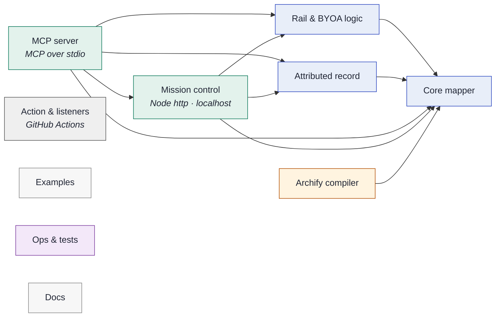

# archwhere — architecture map

_Generated by [archwhere](https://github.com/tapaskar/archwhere) from the declared model. Do not edit by hand._

| Component | Kind | Provider | What it is | Owns |
|---|---|---|---|---|
| **Core mapper** | core |  | Model loading, glob mapping, renderers. | `lib/where.js` `bin/**` `lib/infer.js` |
| **Rail & BYOA logic** | core |  | Attention-rail categorisation, agent mention. | `lib/rail.js` |
| **Attributed record** | core |  | Append-only hash-linked log: specs, decisions, findings, corrections, reviews, claims, owner sign-offs, independent-review check. | `lib/record.js` `lib/record-cli.js` `lib/claims.js` `lib/signoff.js` `lib/review.js` |
| **MCP server** | product | MCP over stdio | archwhere mcp: hand-written JSON-RPC over stdio. Read-only unless --write. No merge or shell tool. | `lib/mcp.js` |
| **Mission control** | product | Node http · localhost | Local UI server + page, and the bridge that lets CLI agents answer board threads. | `lib/mission.js` `lib/bridge.js` `lib/gh.js` `ui/**` |
| **Archify compiler** | feature |  | Model → Archify IR. | `lib/archify.js` |
| **Action & listeners** | infra | GitHub Actions | GitHub Action, consumer workflow templates, agent skill. | `action.yml` `templates/**` `SKILL.md` |
| **Examples** | docs |  | Meridian fictional model. | `examples/**` |
| **Ops & tests** | ops |  | CI and the test suite. | `.github/**` `test/**` `package.json` `package-lock.json` `.gitignore` `arch/**` |
| **Docs** | docs |  | README, license, images. | `*.md` `LICENSE` `docs/**` |

## Process flows (dynamic views)

| Flow | Actor | Path |
|---|---|---|
| **PR gets mapped** | Any pull request | Action & listeners → Core mapper → Action & listeners |
| **Thread to agent reply** | Operator on the map | Mission control → Rail & BYOA logic → Action & listeners → Mission control |
| **Agent asks the owner** | An agent on MCP | MCP server → Mission control → Rail & BYOA logic → MCP server → Attributed record |
| **Claim, review, sign off** | Agents and the owner | MCP server → Attributed record → MCP server → Attributed record → Core mapper → Attributed record |
