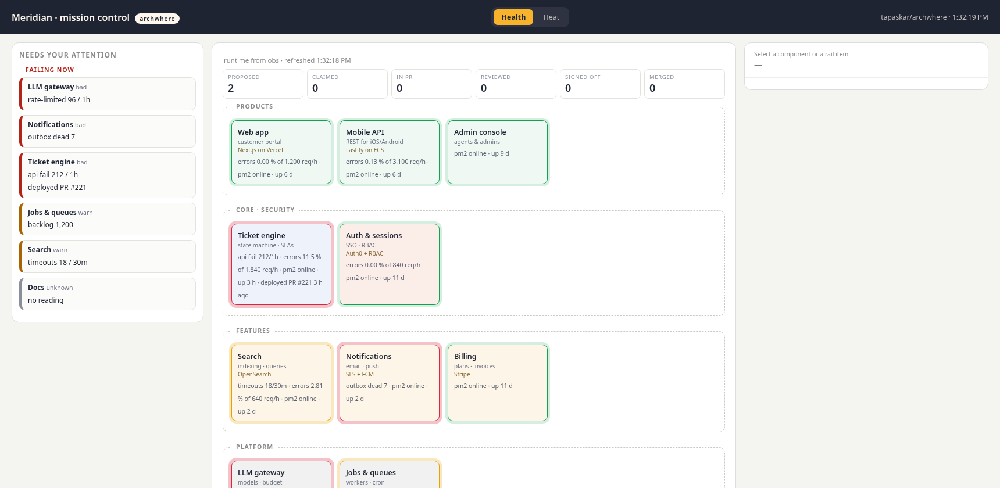
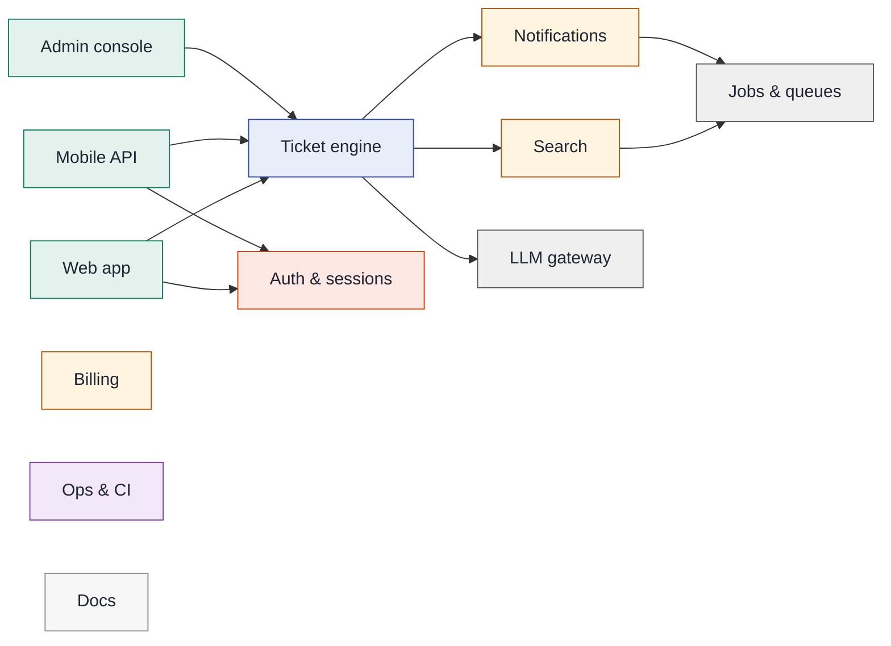

# archwhere

**Your AI coding agents ship thirty PRs a week. Do you know where they land?**

archwhere puts every change — every PR, every task, every agent — on a **declared
architecture map**: which component it touches, whether that component is a
security zone, and what needs you *right now*. Then it goes further: the map
becomes the place you **talk to your agents**.



*Mission control on a fictional product: the attention rail (security → blocked →
needs-attention → ready-to-merge), the component map with live badges, and a
thread pinned to a component — answered by a coding agent, with its PR.*

Zero dependencies. One JSON file. Works with Claude, or any agent that can see GitHub.

## Why

Supervising an agent workforce diff-by-diff doesn't scale. Architecture tools
(Structurizr, IcePanel) assume a human architect maintains the model — so the
model rots. CODEOWNERS and labelers map files to owners but carry no meaning.

archwhere inverts it: **your agents maintain the map as a condition of merging**
(there's a `SKILL.md` that tells them how, and `archwhere check` fails CI when
the map goes stale). You read components, not diffs.

## Quickstart

```bash
npx archwhere init
```

That **drafts the model from your repo itself** — directory structure,
`package.json` workspaces, import edges — with guessed kinds (auth → security,
ui → product, scripts → ops), plus the PR-comment workflow and two agent
listeners. `archwhere check` passes from minute one; you rename and refine
instead of starting from a blank file. It also prints a prompt you paste to
your coding agent so *it* polishes the model by surveying the repo. The
cold-start problem every architecture-as-code tool dies on? Automated.

Daily driver:

```bash
npx archwhere                    # what is my working tree touching?
npx archwhere --base origin/main # what does this branch touch?
npx archwhere check              # CI guard: model valid, no file unmapped, no stale glob
npx archwhere check --fix        # adopt unmapped files into the nearest component
npx archwhere heat               # which components churned most in the last 30 days?
npx archwhere doc --out ARCHITECTURE.md
npx archwhere mission            # the UI at http://localhost:4610
npx archwhere mcp                # MCP server on stdio; read-only unless --write
npx archwhere record verify      # check the shared record's hash chain
```

## The map heals itself

When an agent's PR adds files the model doesn't own, the PR comment doesn't
just complain — it **suggests the exact patch** (adopt into the nearest
component, or create a new one), and `archwhere check --fix` applies it. Tell
your agents "run `check --fix` and review the adopted globs" and the map stays
alive with no human bookkeeping.

## Every PR gets mapped

Add the action (one of the files `init` writes):

```yaml
- uses: tapaskar/archwhere@v1
```

Every PR gets a comment: a component/kind/files table, security flags, and the
system map with touched components highlighted — rendered natively by GitHub:



## Talk to your agents on the diagram

`npx archwhere mission` serves a local UI where the map is the conversation surface:

- **Attention rail** — security items, blocked decisions, PRs needing attention,
  PRs ready to merge (the Merge button uses *your* token; agents never merge).
- **Click any component → open a thread.** Threads are GitHub issues labelled
  `component:<id>` (auto-created). Your agent answers; the reply appears on the map.
- **Six lenses** — Structure / Changes / Heat / Runtime / System flow / Record.
  **Heat** colours components by git churn over the last 30 days — where your
  agents are actually spending effort. **Runtime** colours them by live health
  from any endpoint you point `RUNTIME_URL` at, returning
  `{"components": {"<id>": {"status": "ok|warn|bad", "lines": ["…"]}}}`.
  **System flow** draws the Mermaid system map, with components that have an open
  PR highlighted, and every process flow in your model as a sequence diagram.
  It fetches Mermaid 11 from jsDelivr when opened, pinned by hash.
  **Record** shows, read-only, whether the [shared record](docs/RECORD.md) verifies, active claims and the latest entries.

### Bring your own coding agent

The bus is GitHub — archwhere never talks to an agent directly:

| Your agent | Setup |
|---|---|
| **Claude** | `agent-reply.yml` (written by `init`) answers `@claude` via the Claude GitHub App |
| **Any agent with an API** | `agent-webhook.yml` POSTs each thread event (component, issue, body, HMAC) to `AGENT_WEBHOOK_URL`; it replies with its own GitHub token |
| **Anything already watching GitHub** | nothing to do — have it watch issues labelled `component:*` |

Which mention the UI appends is yours: `arch/mission.config.json →
{"agentMention": "@your-bot"}` (env `AGENT_MENTION` overrides; `""` disables).

### Several agents (Claude + Kiro)

Put more than one agent on the board and choose who answers each message:

```bash
AGENT_MENTIONS="Claude=@claude,Kiro=@kiro" npx archwhere mission
```

or in `arch/mission.config.json`:

```json
{ "agents": [ { "name": "Claude", "mention": "@claude" }, { "name": "Kiro", "mention": "@kiro" } ] }
```

`AGENT_MENTIONS` beats `AGENT_MENTION`, which beats `agents`, which beats `agentMention`. The old
single-agent settings still work, and the first agent is the default.

- **The Ask selector.** With two or more agents, an **Ask:** menu sits next to Send: each agent, plus
  **Both** (two agents) or **All** (three or more). Your last choice is remembered in the browser.
  With one agent you see nothing new.
- **A typed mention wins.** If your message already names any known agent (`@kiro where is…`),
  archwhere adds nothing, so a hand-typed `@kiro` never summons Claude as well.
- **Who replied.** Each reply is tagged with the agent: the Claude GitHub App by its bot login, and
  bridge replies by their `🤖 **Kiro** (via archwhere bridge)` header.

**`archwhere bridge`** lets a CLI agent with no GitHub App answer board threads. Kiro is the example.
It runs on your machine, polls the repo for new issues and comments that mention the agent, runs the
CLI once per mention in a read-only checkout, and posts the answer back as a comment:

```bash
# once: install the read-only Kiro agent (fs_read only, no shell, no writes, no MCP)
mkdir -p ~/.kiro/agents && cp node_modules/archwhere/examples/kiro/archwhere-readonly.json ~/.kiro/agents/

git clone --depth 1 https://github.com/you/repo ~/ro/repo   # a separate checkout just for reading
npx archwhere bridge --repo you/repo --mention @kiro --cwd ~/ro/repo \
  --cmd "kiro-cli chat --no-interactive --agent archwhere-readonly --trust-tools=fs_read"
```

| Flag | Default | |
|---|---|---|
| `--mention` | (required) | handle to watch for, e.g. `@kiro` |
| `--cmd` | (required) | agent command; the prompt is added as the last argument |
| `--cwd` | current dir | where the agent runs: use a read-only checkout |
| `--repo` | `origin` of `--cwd` | `owner/name` |
| `--name` | the mention without `@` | name in the reply header |
| `--allow` | | extra GitHub logins allowed to summon it (the repo owner always is) |
| `--interval` / `--timeout` | 30 s / 300 s | poll interval and per-answer time limit |
| `--state` | `~/.archwhere/bridge-<owner>-<repo>-<mention>.json` | cursor + seen-set, so restarts never answer twice |
| `--once` | | poll once, answer, exit (for cron and tests) |

It uses the same token as mission control (`GITHUB_TOKEN` or `gh auth token`). It runs one job at a
time, strips ANSI colour codes, caps replies at about 60k characters, and posts a short "couldn't
answer" note when the agent fails or times out.

**Security notes**

- **Allow-list.** Only the repo owner and the logins in `--allow` can summon it. Bots are never
  answered, and neither are the bridge's own replies (it spots them by the header). On a public repo
  this matters: anyone can comment, and the comment becomes the agent's prompt.
- **Read-only.** Point `--cwd` at a separate checkout that nothing deploys from, and give the agent
  read-only tools: the `archwhere-readonly` Kiro agent above exposes only `fs_read`, and
  `--trust-tools=fs_read` pre-approves only that tool.
- **Never trust all tools.** The bridge refuses to start if `--cmd` contains `-a` or
  `--trust-all-tools`.
- **No shell.** The command is split once and run with `execFile` and an argument array. The thread
  text goes in as one argument and is never shell-interpolated.
- **No pings.** `@handles` in the agent's answer are broken with a zero-width space, so an answer
  can't summon another agent or notify people.

## Give your agents the map over MCP

```bash
claude mcp add --transport stdio archwhere -- npx -y archwhere mcp
```

`archwhere mcp` serves the map, what a file or diff touches, the attention rail, threads and the record to any MCP
client. It is hand-written JSON-RPC over stdio with no dependencies. It speaks the current protocol (2026-07-28) and the
older `initialize` handshake.

It is **read-only by default**. With `--write` and a declared identity, agents can also store specs, findings and
decisions, claim tasks, and ask the owner one question, which lands under Blocked. There is **no merge tool and no shell
tool**, and agents can't sign off. Output from GitHub and the record is marked as untrusted data.

Setup for Claude Code, Kiro and Hermes, the tool list and the safety rules: [docs/MCP.md](docs/MCP.md).

## A shared, attributed record

Agents forget, and GitHub threads don't say who decided what. `archwhere record` is an append-only log that every agent
reads and writes, with each entry naming its author, agent, model and vendor:

```bash
archwhere record spec put ticket-sla --file specs/sla.md --components ticket-engine   # word for word, SHA-256, versioned
archwhere task claim T-12 --role builder --branch feat/sla                            # atomic; one writer per branch
archwhere record search holidays --component ticket-engine
archwhere record independent --task T-12    # did a different vendor and model approve this? exit 0 or 1
archwhere record signoff --target <hash> --decision approve --signer dana             # owner signature, from a terminal
archwhere record verify                     # detects edits, deletions and reordering
archwhere record anchor --tag --push        # keep the head hash somewhere else
```

Be clear about what this is:

- **Tamper-evident, not tamper-proof.** Someone with disk access can rewrite the whole chain. Only an anchor kept
  elsewhere exposes that, and deleting the newest entries breaks no link either.
- **Vendor and model are self-declared.** The independent check confirms what was recorded, not what ran.
- **A sign-off holds only while an agent can't get the key and its passphrase and can't change the trust list.**
- **Claims are atomic on one filesystem and advisory.** Claims from separate clones can collide; that is reported on
  import, not prevented.
- **Not committed by default**, because it can hold sensitive text. In a public repo, committing it publishes it for good.

Storage, concurrency, merge behaviour and every limit: [docs/RECORD.md](docs/RECORD.md).

## The model

One file, declared judgment — not an auto-extracted import hairball:

```jsonc
{
  "system": "Meridian",
  "components": {
    "auth": {
      "name": "Auth & sessions", "kind": "security",
      "provider": "Auth0 + RBAC",               // shows on every surface: map, PR comment, docs, mission UI
      "paths": ["core/auth/**"],                  // ** crosses dirs, * stays in one; longest match wins
      "watch": [{ "pattern": "session|token|rbac", "note": "security review" }],
      "deps": []
    }
  },
  "lanes": [["web-app"], ["auth"]],               // optional; defaults to kind grouping
  "flows": { "signup": { "name": "…", "actor": "…", "steps": [{"from": "web-app", "to": "auth", "label": "SSO"}] } }
}
```

Kinds: `core · security · feature · infra · product · ops · docs`. `flows` are
your C4-style dynamic views — the process layer above the components. The full
example: [`examples/meridian/architecture.json`](examples/meridian/architecture.json).

## Interactive diagrams (Archify)

`npx archwhere ir` compiles the model into [Archify](https://github.com/tt-a1i/archify)
IR — an animated signal-flow system diagram with trust boundaries and guided
views per flow, plus one numbered diagram per flow. Render with Archify's CLI.

## For your agents

[`SKILL.md`](SKILL.md) is the agent's side of the contract: place work on the map
before coding, extend the model when adding modules, update flows when changing
user-visible processes, keep `archwhere check` green. Works as a Claude Code /
agent skill, or paste it into your agent's instructions.

## Compared to…

| | maps PRs | visual | agents maintain it | talk to agents on it |
|---|---|---|---|---|
| CODEOWNERS / labeler | ✓ | — | — | — |
| Structurizr / IcePanel | — | ✓ | — | — |
| dependency graphs | ✓ | hairball | n/a | — |
| **archwhere** | ✓ | ✓ | ✓ | ✓ |

### Compared to OnMemory

[OnMemory](https://onmemory.ai/#how) describes a similar loop: a spec kept verbatim, agents on several models writing to
one memory, review by another vendor's model, and attributed sign-off. It is in closed test. We haven't used it, and what
follows about it comes only from its public page.

| | archwhere | OnMemory's page says |
|---|---|---|
| Spec kept word for word | SHA-256 addressed, versioned | keeps it verbatim |
| Shared memory | Local append-only log, exportable, not hosted | all writing to one memory |
| Cross-vendor review | Recorded and checked on declared data; archwhere doesn't run the reviewers | a different vendor's model reviews |
| Provable history | Tamper-evident hash chain, with limits [spelled out](docs/RECORD.md#what-record-verify-proves) | history is provable |
| Retrieval | Plain-text, component and task search | its own retrieval method; archwhere has no equivalent |

archwhere is open source (MIT) and also puts the work on an architecture map.

## Onboarding at a glance

From stranger to agent-replies-on-the-map in under twenty minutes — the full
funnel, stage by stage: [docs/ONBOARDING.md](docs/ONBOARDING.md).

## License

MIT © Tapas Kar. Built with and for AI coding agents — this repo's own model
lives in [`arch/architecture.json`](arch/architecture.json), of course.
